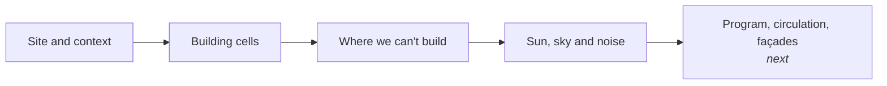

# How the model works

This page explains the Houdini network in `main.hipnc`: what it does, how it is laid out, and where to change things. Read it once before you open the scene; you don't need to look inside the nodes to follow it.

## The idea

We don't draw the building. We describe the space it could take, cut that space into small cells, and let rules and measurements decide what each cell can be.

1. **Site and context**: read where the building may stand, and the city around it.
2. **Building cells**: fill each building volume with cells.
3. **Where we can't build**: block the cells that break a rule (roads, existing buildings, setbacks, …).
4. **Sun, sky and noise**: measure, for every cell that is left, how much sun, sky and noise it gets.
5. **Next**: place the program on the cells, add cores and stairs, terraces and façades.

Each step only adds information to the cells. Nothing is thrown away, so you can always see *why* a cell ended up the way it did.

## Finding your way in the network

Everything lives in `/obj/SAMY`. The network reads from top to bottom, in five boxes:

| Box | What happens | Look at |
| --- | --- | --- |
| **Site and context** | Reads the building areas, the 3D BAG buildings and the base map | `OUT_BUILDING_AREAS`, `OUT_STANDING_BUILDINGS`, `OUT_MAP` |
| **Building cells** | Floors, volume and grid per building, then the cells | `OUT_CELLS` |
| **Where we can't build** | One rule after the other blocks cells | `OUT_CONSTRAINED_CELLS` |
| **Sun, sky and noise** | Shadow on the neighbours, then sun, sky and noise per cell | `OUT_ENVIRONMENT_CELLS` |
| **Previews** | Coloured boxes and squares to look at; nothing reads them | `OUT_CONSTRAINT_PREVIEW`, `OUT_ENVIRONMENT_PREVIEW` |

Two kinds of nodes help you navigate:

- **`OUT_` nulls** mark the result of each step. They are the hand-over points: later steps (and teammates) read from them, so don't rename them.
- **`VIEW`** merges what is shown in the viewport by default. To look at something else, set the display flag on any `OUT_` node.

## Cells

A **cell** is one grid square on one floor of one building: by default 3.6 × 3.6 m, one floor high. In the geometry it is a single point in the middle of that square and floor.

Every cell starts **free**. Rules can change that:

- `blocked`: a rule says no building here. `reason` says which rule.
- `outside_envelope`: the cell would shade the Provenierswijk homes for too long.

Blocked cells stay in the geometry, so you can always ask why.

### What a cell stores

| Attribute | Meaning |
| --- | --- |
| `name` | The building the cell belongs to |
| `level` | The floor, `0` = ground floor |
| `voxel_id` | The cell's number |
| `state` | `free`, `blocked` or `outside_envelope` |
| `reason` | Why it is blocked, e.g. `road`, `existing building`, `setback: buildings` |
| `existing` | The site element it lies in (e.g. the Biergarten), if any |
| `shadow_hours_provenierswijk` | Hours its shadow falls on sunny Provenierswijk homes, over all sun days |
| `sun_hours_<mmdd>_<side>` | Hours of direct sun on one side (`n`, `e`, `s`, `w`) on one sun day, e.g. `sun_hours_0621_s` |
| `svf_<side>` | Sky view factor on that side: the share of the sky it sees (0–1) |
| `noise_<source>_<side>` | Noise on that side in dB Lden, per source (`train`, `road`) and `total` |
| `sun_access` | `1` if some side gets direct sun on some sun day, `0` if never |

Measured values are `-1` on cells that weren't measured (blocked cells).

### Why windows?

Sun and noise differ per side of a cell: a south side gets sun, a north side doesn't. So each free cell gets four **windows**, points just outside each side face. The windows are measured, and their values are copied back onto the cell as one attribute per side (`_n`, `_e`, `_s`, `_w`).

## Modules

Every node in the five boxes is a **module**: a small asset that does one job. Its name says what it does (`block_near`, `noise_at`, `make_cells`), and the help (F1 on the node) explains its inside.

Some modules are used more than once with different settings. The four *Block inside* nodes, for example, run the same network on roads, existing buildings, drawn zones and no-build volumes. The comment under each node says what that copy does. Change the inside once and every copy follows.

Modules come in five kinds, one folder each in `hda/`:

**Read**: bring one kind of input into the scene.

| Module | Does |
| --- | --- |
| `read_wkt` | Reads a CSV of shapes (building areas, zones, setbacks, …) |
| `read_3dbag` | Reads the 3D BAG buildings: 3D models and footprints |
| `keep_existing` | Keeps only buildings that stand today and are not demolished |
| `road_zones`, `building_zones`, `drawn_zones` | Turn roads, existing buildings and drawn shapes into **zones** |
| `site_elements` | Site elements with their chosen treatment: zones to block, shapes to tag |
| `custom_volumes` | Closed shapes that block every cell inside them |
| `noise_map`, `noise_sources` | The RIVM noise maps and the noise source lines |
| `read_area` | An outline as a solid, for inside tests (e.g. Provenierswijk) |

A **zone** is a flat outline on the ground with a `reason` and the floors it blocks (`first_floor`, `last_floor`, `-1` = to the top).

**Cells**: make and move cells.

| Module | Does |
| --- | --- |
| `floors` | One point per floor, per building |
| `building_volume` | The footprint extruded to the building's height |
| `grid_direction` | Turns the grid along the longest footprint edge |
| `make_cells` | The cells: one shared grid, kept inside each building |
| `windows` | Four windows per cell |
| `window_values_to_cells` | Window values back onto their cells, one per side |

**Rule**: change the state of cells; they measure nothing themselves.

| Module | Does |
| --- | --- |
| `block_inside` | Blocks free cells inside zones or closed volumes |
| `block_near` | Blocks free cells closer than a distance (setbacks) |
| `block_setback_shapes` | Blocks free cells too close to a shape with its own setback |
| `block_over_limit` | Gives free cells over a limit a new state (the envelope) |
| `mark_inside` | Tags cells inside a shape with its name |

**Measure**: add a value; they never change a cell's state.

| Module | Does |
| --- | --- |
| `sun_positions`, `sky_directions` | Where the sun is on each sun day; directions over the sky |
| `shadow_on` | How long each cell shades a sunny area |
| `count_clear_rays` | Per window, adds up the directions it can see (sun hours, sky view) |
| `noise_at`, `noise_total` | Noise per window, per source and all together |
| `distance_to` | Distance in plan to the nearest shape |
| `sun_access` | Whether a cell gets sun at all |

**Show**: previews only (`base_map`, `road_outlines`, `zone_blocks`, `blocked_preview`, `cell_states_preview`, `window_values_preview`, `cell_preview`).

## Changing the model

Most changes are a setting on the `CONTROL` node. Its tabs follow the steps:

| Tab | Holds |
| --- | --- |
| Project | Origin, context radius, latitude |
| Existing city | Which buildings count as standing, which are demolished |
| Buildings | Number of floors and floor heights, per building or the default |
| Grid | Cell size, whole cells only |
| Rules | Roads, existing buildings, site elements, the Provenierswijk shadow limit |
| Sun and sky | Sun days, time step, sky detail |
| Noise | Noise reduction on the back side |
| View | What the previews show |

A few things live elsewhere:

- **Input files** are set on the node that reads them, e.g. the zones file on `drawn_zones`.
- **Space to keep empty** (a passage, a light well, …): add a closed shape, such as a Box or a Curve with PolyExtrude (both ends closed), and wire it into `NO_BUILD_VOLUMES`. The cells inside it are blocked, in 3D, so a box from 6 to 12 m only blocks those floors.

Don't choose *Allow Editing of Contents* on a module: that node stops following its asset. If a module needs to behave differently, it needs a new setting.

## Adding to the model

New steps follow the same pattern:

- A new **limit on where we build** is a rule module that sets `state` and `reason` on free cells.
- A new **value per cell** is a measure module that adds an attribute and leaves `state` alone.
- A new **step** ends in an `OUT_` null, so the next step has a clear place to read from.
